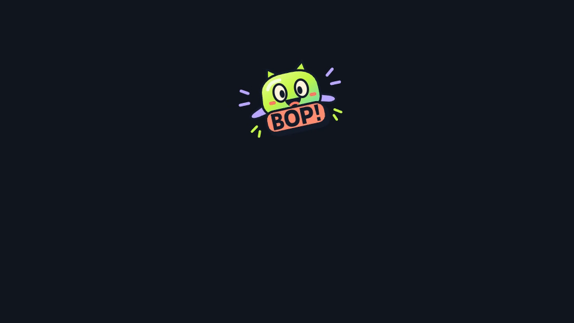

# Voice Motion Lab

**움직임을 소리로 연기하면, 수정할 수 있는 애니메이션이 됩니다.**

Upload an original SVG, record a five-second voice performance (or import audio),
and make a motion clip. Sustained sound advances the path, silence holds it,
voiced pitch adds vertical expression, and sharp attacks add elastic impacts.
The app exports an animated SVG, an editable JSON project with sampled transform
keyframes, and a WebM video with optional original audio.

This is a working local v0.1 prototype, not a submitted contest entry. Voice Motion
does not infer arbitrary sound meanings. A sound such as “whoosh” is analyzed for
its timing, pitch and energy, rather than interpreted as a natural-language command.

**Development status:** this is a production-test prototype, not the final contest
submission. The next product direction is a playful, accessible sound-to-mascot
web app: choose a character, perform for five seconds, preview, save a video.
See [the production plan](docs/PRODUCTION_PLAN.md) for browser/server boundaries
and the planned official SDK integration.
The [browser inference proof](docs/BROWSER_PROOF.md) now demonstrates actual
single-thread CPU WASM model execution. The full browser-only play mode is not yet
implemented; the Studio below still uses its local Python/Comfy analysis service.

## Watch the BOP! production tests

With the local app running, open **http://127.0.0.1:8793/production/index.html**.
Three original mascots and original synthetic performances were uploaded and
exported through the actual app and isolated Comfy analysis workflow. The gallery
contains unchanged WebM/SVG/JSON exports, source SVG/WAV, and a hash manifest.
All audio in this gallery is synthetic; no person's recording was published.



## Run on Windows

Python 3.12 is recommended. All installs are project-local.

```powershell
./setup.ps1 -Python python -WithModel
./start.ps1
```

Open **http://127.0.0.1:8793**. Use **합성 데모 체험** first, or upload an SVG and
record. The built-in demo and `tests/fixtures/synthetic-performance.wav` are
synthetic, not recordings of a person.

- Click recording yourself to grant microphone access. The app never requests it on load.
- Import audio: up to 15 seconds; the browser decodes and downmixes locally.
- Original SVG: up to 1 MiB, static vector profile. Scripts, remote images/fonts,
  external URLs, foreign objects and active animation are rejected.
- Choose Fly / Bounce / Orbit, adjust intensity and spring smoothness, then export.
- Reopen a project JSON to edit and export again. JSON includes the original audio samples.
- WebM export runs in real time in a foreground tab. Browser support for audio/video
  recording is required. SVG contains animation but no audio.

## Optional isolated Comfy workflow

The current integration uses the native **ComfyUI Server API** (`/prompt`).
An official Comfy SDK/API v2 integration is planned for the submission build;
the current route is not a claim of confirmed contest eligibility.
Do not install this pack into an
existing ComfyUI. The supplied setup creates a separate CPU runtime inside this
checkout and never connects to port 8188.

```powershell
./tools/setup_comfy.ps1 -Python python
./start-comfy.ps1
# In a second terminal:
./start.ps1 -WithComfy
```

The separate runtime is pinned to ComfyUI commit
`bdc63e72f5ab29fde448c161db3057827148c0ef` and uses port **8794**. CPU-only
PyTorch and ONNX sessions avoid using GPU memory. CPU threads are capped at two.
The advanced connection details in the app show whether the workflow route is enabled.

`VoiceMotionAnalyze` turns mono samples into timed motion analysis.
`VoiceMotionProject` packages source SVG, audio, settings and analysis as editable JSON.
API and editable GUI examples are in `workflows/`. The web renderer is shared by
preview and exports; the Comfy project node does not pretend to render a video.

## Model and fallback

`tools/setup_model.py` downloads the official Spotify Basic Pitch ONNX model from
commit `fa5997af0a8210982619003269994a1be25eddf3`, into `.runtime/models/` only.
SHA-256: `2c3c1d144bfa61ad236e92e169c13535c880469a12a047d4e73451f2c059a0ec`.
The model is approximately 225 KiB and uses `CPUExecutionProvider`.

Basic Pitch supplies pitch/onset features; deterministic signal processing and
motion mapping produce the animation. The **signal** engine is a real fallback,
explicitly labeled “AI 아님”. Explicit model mode fails clearly when the model is
unavailable; auto mode reports a warning when it falls back. No paid API is used.

## Isolation

Everything belongs to this checkout: `.venv`, `.comfy-venv`, `.runtime`, `.cache`,
`models`, `input`, `output`, `temp`, and `user`. Neither setup script reads existing
Comfy configuration or shared models. The optional Comfy runtime loads only this
project's custom pack and disables partner nodes/internet in its frontend.

Run `./.venv/Scripts/python.exe tools/check_resources.py` before starting heavier
experiments. It reads available RAM, disk and target ports without controlling
other jobs. Shutdown is limited to terminals/processes started for this checkout.
For the recorded background servers created during development, `./stop.ps1`
checks launcher paths, process identity and an empty project queue before stopping
only their process trees. `./stop.ps1 -WhatIf` previews the targets. For servers
started manually in terminals, use Ctrl+C in those terminals.

The local service binds only to loopback. It validates Host/Origin, caps request
size, and does not write uploaded audio. Saving a project JSON includes audio by
design. Do not publish a project containing a private recording inadvertently.

## Verification

```powershell
./.venv/Scripts/python.exe -m unittest discover -s tests -p 'test_*.py' -v
node --test tests/web/*.test.mjs
# With this project's two services running:
./.venv/Scripts/python.exe tools/verify_api.py
```

Tests cover silence/noise, timing, actual CPU model inference when installed,
malformed payloads, SVG safety, motion/export consistency and project round trips.
Node stub tests are not represented as proof of actual Comfy execution; the API
verification explicitly queues the independent project workflow and checks history.

See `VERIFICATION.md` for the recorded end-to-end checks and limitations of this build.

## License

Original app and custom pack: MIT. Basic Pitch: Apache-2.0; its original license is
saved beside the downloaded model. Independent ComfyUI runtime: GPL-3.0, downloaded
separately and excluded from this repository. See `NOTICE` for source provenance.
